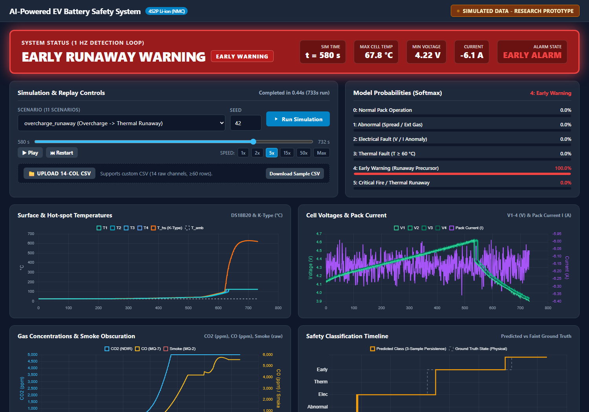

# AI-Powered EV Battery Fault and Fire Detection System

[](https://www.python.org/downloads/)
[](https://opensource.org/licenses/MIT)
[](https://fastapi.tiangolo.com/)
[]()

A software-only research prototype of an AI-powered EV battery fault, degradation, and early thermal runaway detection system for **4S2P Lithium-ion (NMC) battery packs**.

Designed for high-reliability Battery Management Systems (BMS), the system integrates first-principles physical-chemical dynamics (first-order Thévenin ECM, dual-node lumped thermal, Arrhenius chemical decomposition, and multi-gas mass balance) with high-rate sensor modeling (lag, offset, Gaussian noise, and ADC quantization) and multi-class machine learning models.

---

## Web Dashboard Demo

The prototype includes an interactive web dashboard (`app.py` + `index.html`) featuring real-time 1 Hz simulation, live-updating Chart.js telemetry, an adaptive multi-tier safety status banner, model probability distributions, and CSV data replay.



*Shown: Pre-runaway early warning detection during an overcharge scenario ($t = 580\text{ s}$), providing over **4.3 minutes of lead time** before thermal runaway onset.*

---

## Key Capabilities & Architecture

- **Pack Configuration**: 4S2P (4 series groups, 2 parallel cells per group, 5 Ah nominal capacity per group with $\pm 2\%$ cell-to-cell capacity variation).
- **14 Sensor Channels (1 Hz)**:
  - Cell group voltages: $V_1, V_2, V_3, V_4$ (1 mV step, 3 mV noise, $\pm 5\text{ mV}$ offset).
  - Pack current: $I$ (0.06 A noise, $\pm 0.08\text{ A}$ offset, clipped at $\pm 20\text{ A}$).
  - Surface temperatures: $T_1, T_2, T_3, T_4$ (DS18B20 model, $\tau = 8\text{ s}$, 0.0625°C step).
  - Hot-spot surface temperature: $T_{hs}$ (K-type thermocouple, derived from hottest surface group, $\tau = 2\text{ s}$, 0.25°C step).
  - Ambient temperature: $T_{amb}$.
  - Gas sensors: Smoke obscuration (MQ-2, $\tau = 6\text{ s}$), Carbon Monoxide CO (MQ-7, $\tau = 15\text{ s}$, 90s/150s duty-cycle hold), Carbon Dioxide $CO_2$ (NDIR, $\tau = 45\text{ s}$, 10 ppm noise, 0–5000 ppm range).

### Six-Class Safety Hierarchy

```
Priority: 5 (Critical) > 4 (Early Warning) > 2 (Electrical Fault) > 3 (Thermal Fault) > 1 (Abnormal) > 0 (Normal)
```

| Class | Description | Physical Ground Truth Condition |
| :---: | :--- | :--- |
| **0** | **Normal** | All voltages, currents, temperatures, and gas channels within nominal limits. |
| **1** | **Abnormal** | Core temp 45–60°C, or surface spread $\ge 8^\circ\text{C}$, or cell imbalance $\ge 60\text{ mV}$, or external gas ($CO > 30\text{ ppm}$ or $CO_2 > 1200\text{ ppm}$). |
| **2** | **Electrical Fault** | Cell voltage $\ge 4.25\text{ V}$ or $\le 2.80\text{ V}$, or current $|I| \ge 15\text{ A}$ (5s average) or $\ge 30\text{ A}$ (instantaneous). |
| **3** | **Thermal Fault** | Core temperature $\ge 60^\circ\text{C}$ with electrical state normal. |
| **4** | **Early Warning** | Decomposition chemical heat $\ge 0.3\text{ W}$, or true SOC $> 108\%$ with active overcharge side-reaction off-gassing. Active until runaway onset. |
| **5** | **Critical Fire / Runaway** | Self-heating rate $\ge 1^\circ\text{C/s}$ ($\dot{Q}_{chem} / C_c \ge 1$). Latched until end of run. |

---

## 11 Operational & Fault Scenarios

1. `normal_drive`: Dynamic charge/discharge drive cycle ($\le 2.5\text{C}$ discharge, $\le 1\text{C}$ regen).
2. `normal_charge`: Standard CC-CV charging profile.
3. `hot_ambient`: Ambient temperature stress ($45^\circ\text{C}$) under normal driving.
4. `external_gas`: Exogenous smoke/CO/CO2 interference without battery failure.
5. `overcurrent`: Sustained 15.5–19.5 A current stress.
6. `over_discharge`: Discharge past 2.8 V cut-off.
7. `cooling_failure`: Heat dissipation reduced to 25% (simulating fan failure).
8. `overcharge_runaway`: Sustained overcharge leading to side-reaction venting, internal dendrite short, and catastrophic thermal runaway.
9. `internal_short_runaway`: Severe internal micro-short ($R_{ISC} \approx 0.08\,\Omega$) driving rapid self-heating and thermal runaway.
10. `overcharge_aborted`: Overcharge terminated safely by BMS at 102–112% SOC (no runaway).
11. `soft_internal_short`: Mild internal short ($R_{ISC} = 2\text{--}6\,\Omega$) dissipating low heat without runaway.

---

## Model Benchmark Results (Phase 2)

Evaluated across **106,119 test windows** (1 Hz resolution, 78 test runs):

| Model | Val Macro-F1 | Test Macro-F1 | Test Accuracy | Overcharge Runaway Lead Time (Median) | Internal Short Runaway Lead Time (Median) | False Alarms / Hour |
| :--- | :---: | :---: | :---: | :---: | :---: | :---: |
| **Threshold Baseline** | 0.7249 | 0.7646 | 88.24% | 286.0 s | 181.0 s | 0.651 / h |
| **Balanced Random Forest (Selected)** | **0.9295** | **0.9228** | **95.76%** | **269.0 s** | **97.0 s** | **0.498 / h** |
| **1D-CNN (CPU)** | 0.8619 | 0.8905 | 91.65% | 260.0 s | 93.5 s | **0.115 / h** |

### Gas Sensor Ablation Study
Removing gas sensors (Smoke, CO, CO2) from the feature set:
- Causes a **+46.2% surge in false alarms** (from 0.498 to 0.728 alarms/hour) because external gas and thermal fluctuations cannot be distinguished from internal faults.
- Degrades Class 1 (Abnormal) F1-score from **0.9664 down to 0.8487** (-12.2%).
- Shrinks the maximum early warning lead time in overcharge by **38 seconds** (368 s down to 330 s) due to loss of early off-gas venting detection.

---

## Quickstart & Installation

### 1. Prerequisites
- Python 3.10+
- Recommended: Windows, macOS, or Linux

### 2. Clone the Repository
```bash
git clone https://github.com/Amardighe1/AI-powered-EV-battery.git
cd AI-powered-EV-battery
```

### 3. Install Dependencies
```bash
pip install numpy scipy scikit-learn torch joblib fastapi uvicorn matplotlib pytest
```

### 4. Run the Web Dashboard
```bash
python app.py
```
Open your browser at **`http://127.0.0.1:8000`** to view the live simulation, test scenarios, upload custom CSVs, and adjust playback speeds.

### 5. Run the Unit Test Suite
```bash
python -m pytest tests/ -v
```
All 12 physical validation and regression tests check:
- Scenario completeness & 20-seed runaway exclusivity.
- Bitwise reproducibility across seeds.
- Physical bounds ($T < 1200^\circ\text{C}$, $0 \le SOC \le 1.5$).
- Class 5 latching and Class 4 precursor timing.
- Independence of ground-truth labels from sensor noise.
- Sensor lag time constants ($\tau$), noise variance, and quantization clipping.

---

## Project Structure

```
├── app.py                      # FastAPI demo application backend
├── index.html                  # Interactive single-file frontend dashboard (Chart.js)
├── PARAMETERS.md               # Physics parameter catalog (literature vs assumptions)
├── BENCHMARK_20_SEEDS.md       # Multi-seed validation statistics across 220 simulation runs
├── artifacts/                  # Trained ML artifacts
│   ├── best_model.joblib       # Balanced Random Forest classifier (Phase 2)
│   ├── scaler.joblib           # StandardScaler fitted on Train split
│   ├── feature_names.json      # 34 engineered sensor feature names
│   └── metadata.json           # Comprehensive model evaluation and benchmark metrics
├── docs/                       # Technical reports
│   ├── PHASE_1_REPORT.md       # Phase 1 Simulator validation report
│   └── PHASE_2_REPORT.md       # Phase 2 ML benchmarks & ablation study report
├── plots/                      # Generated visual outputs & screenshots
│   ├── runaway_screenshot.png  # Web dashboard runaway state capture
│   └── confusion_matrix_*.png  # Model confusion matrices
├── src/
│   ├── ml/                     # Feature extraction, dataset building, models, evaluation
│   │   ├── features.py         # 34-feature extraction pipeline (sensor-only)
│   │   ├── dataset.py          # Windowing engine & data leakage verification
│   │   ├── models.py           # Threshold, Random Forest, and 1D-CNN architectures
│   │   └── evaluate.py         # 1 Hz run-level alarm metrics & lead-time evaluation
│   ├── models/                 # Physical battery models
│   │   ├── ecm.py              # First-order Thévenin equivalent circuit model
│   │   ├── thermal.py          # Two-node thermal + Arrhenius chemical self-heating
│   │   ├── gas.py              # Mass balance gas generation and enclosure venting
│   │   └── sensors.py          # Sensor lag (PT1), noise, offset, and quantization
│   └── simulation/             # Physics runner and scenarios
│       ├── runner.py           # Sub-stepping adaptive ODE solver (generate_run)
│       └── scenarios.py        # 11 scenario definitions and parameter randomizers
├── tests/
│   └── test_simulator.py       # Comprehensive pytest suite
└── scripts/
    ├── train_and_evaluate.py   # End-to-end model training, evaluation & ablation script
    ├── generate_dataset_mp.py  # Multi-process 390-run dataset generation
    └── capture_screenshot.py   # Headless browser screenshot utility
```

---

## License

This project is licensed under the MIT License - see the LICENSE file for details.
